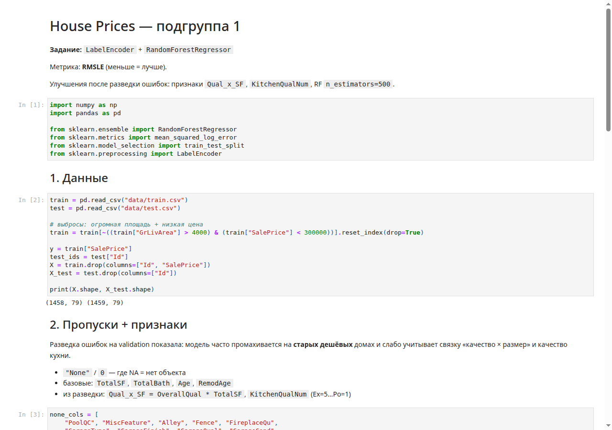

# House Price Prediction

My first classical ML project: predict house sale prices on the [Ames Housing](https://www.kaggle.com/competitions/house-prices-advanced-regression-techniques) dataset.

<p>
  
  
  
  
</p>

## What it does

- Train on houses with known `SalePrice`
- Predict prices for unseen houses → `submission.csv`
- Metric: **RMSLE** on a held-out validation split (≈ **0.136**)

## Approach

| Step | Details |
|------|---------|
| Encoding | `LabelEncoder` for categorical features |
| Model | `RandomForestRegressor` |
| Target | `log1p(SalePrice)` / `expm1` for predictions |
| Features | missing-value handling, `TotalSF`, `Age`, `Qual_x_SF`, `KitchenQualNum`, … |
| Tuning | grid search in `tune_rf.py` |

## Notebook preview

[](house_prices_lab.ipynb)

Open the full notebook: [`house_prices_lab.ipynb`](house_prices_lab.ipynb)

## Run locally

```bash
python3 -m venv .venv
source .venv/bin/activate
pip install -r requirements.txt
jupyter notebook house_prices_lab.ipynb
```

Optional hyperparameter search:

```bash
python tune_rf.py
```

## Repo layout

```text
house_prices_lab.ipynb   # main solution
submission.csv           # predictions for test
tune_rf.py               # RF grid search
data/                    # train.csv / test.csv
DEFENSE.md               # notes for lab defense (RU)
```

## License / course

Sfedu AI lab assignment — subgroup: LabelEncoder + RandomForestRegressor.
